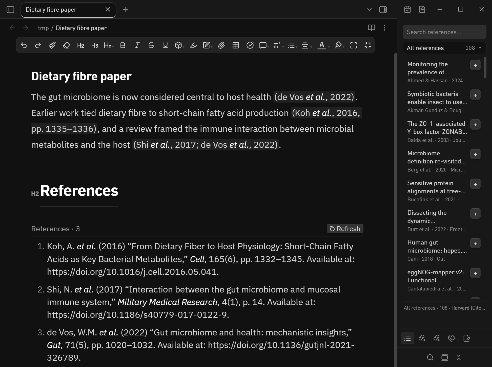

# EndNote Cite（Obsidian 插件）

在 Obsidian 里像用 Word 的 EndNote 插件那样：**边写边插入引用**，文献直接读自 EndNote
的 `.enl` 库，写完一键**导出 Word / LaTeX**。

*[English](README.md)*



## 能做什么

| 功能 | 说明 |
|---|---|
| **读文献库** | `.enl` 本身就是 SQLite 数据库，插件只读打开；EndNote 里一增删文献，Obsidian 里 5 秒内自动刷新。 |
| **边写边引** | 正文输入 `[@` 弹出搜索框（作者 / 标题 / 年份 / 期刊），回车插入 `[@引用键]`。 |
| **实时格式化** | `[@deVos2022]` 在正文里显示成 `(de Vos et al., 2022)` 或 `[1]`，光标移进去就变回源码，方便改。 |
| **跟随 EndNote 样式** | 读取 EndNote 当前选中的 Output Style 名字，自动匹配最接近的 CSL 样式；也可指定任意 `.csl`。 |
| **参考文献表** | 命令面板“插入参考文献表”，或用 ` ```endnote-bib ` 代码块生成可刷新的列表。 |
| **导出** | `.docx`（带参考文献，可套自己的 Word 模板）、`.tex` + `.bib`、`.bib`、CSL-JSON。 |
| **文献库侧边栏** | 搜索文献、浏览 EndNote 分组、点一下加号就插入引用。 |
| **界面语言** | 英文（默认）或简体中文，命令、侧边栏、提示、设置页全部跟着切换。 |
| **EndNote 原生 Word 输出** | 第二种 Word 导出：交给 Word + EndNote 自己写 `ADDIN EN.CITE` 域，和在 Word 里点「Insert Citation」得到的完全一样。 |

## 两种 Word 导出怎么选

| | `导出为 Word (.docx)` | `导出为 Word（EndNote 可更新域）` |
|---|---|---|
| 生成方式 | pandoc + citeproc，全程离线 | pandoc → 由 Word + EndNote 执行 `ENFormatBibliography` |
| 引用内容 | 排版好的文字 | 真正的 EndNote 域 + 旅行图书馆 |
| 以后换样式 | 不能，只能重新导出 | 能 —— EndNote ▸ Update Citations and Bibliography |
| 改引用（加页码、删掉） | 不能 | 能 —— EndNote ▸ Edit & Manage Citations |
| 速度 | 约 1 秒 | 约 10 秒（后台驱动 Word 和 EndNote） |
| 依赖 | pandoc | pandoc + Word + 装了 CWYW 加载项的 EndNote |
| 文件名 | `笔记.docx` | `笔记 (EndNote).docx` |

## 前置条件

- 桌面版 Obsidian 1.5 以上（用到 Node 能力，移动端不支持）。
- EndNote（`.enl` 为 SQLite 的版本，EndNote 20/21/2025 都是）。
- 导出 Word/LaTeX 需要 [pandoc](https://pandoc.org/installing.html) 在 PATH 里。

## 安装

1. 把本文件夹放到 `<你的 vault>/.obsidian/plugins/endnote-cite/`，里面要有
   `main.js`、`manifest.json`、`styles.css`。
2. 设置 → 第三方插件 → 启用 **EndNote Cite**。
3. 打开插件设置，确认 `.enl` 路径已被自动识别。

## 写作

```markdown
肠道菌群与宿主健康密切相关 [@deVos2022]。
膳食纤维为短链脂肪酸产生菌提供底物 [@Koh2016, pp. 1335-1336]。
一个方括号里放多条：[@Shi2017; @deVos2022]。
```

- 输入 `[@` 触发补全，回车插入。
- <kbd>Ctrl/Cmd</kbd>+<kbd>P</kbd> → “EndNote: 插入引用”打开搜索窗，
  <kbd>Shift</kbd>+<kbd>Enter</kbd> 可以一次挑多条。
- `[@key, p. 12]` 加页码，语法与 pandoc 一致，导出时不会丢。

## 导出

命令面板 → `EndNote: 导出为 Word (.docx)` / `导出为 LaTeX (.tex + .bib)`。

导出文件放在笔记旁边（或设置里指定的文件夹）。Word 保留原名；
LaTeX 的文件名会把空格换成下划线（`My Paper` → `My_Paper.tex`），
因为 BibTeX 的 `\bibliography{}` 不支持空格。

编译 LaTeX：

```bash
pdflatex My_Paper.tex
bibtex   My_Paper
pdflatex My_Paper.tex
pdflatex My_Paper.tex
```

## EndNote 原生 Word 输出（引用可更新）

命令 `EndNote: 导出为 Word（EndNote 可更新域）` 生成的 `.docx` 会被 EndNote 当成自己的文档：

1. 插件把每个 `[@key]` 换成 EndNote 的临时引用 `{Koh, 2016 #4@1335}`；
2. pandoc 先排好版；
3. 后台启动 Word，调用 EndNote 的 `ENFormatBibliography` 宏，**让 EndNote 自己**
   把临时引用改写成 `ADDIN EN.CITE` 域（内嵌完整文献记录），并生成
   `ADDIN EN.REFLIST` 参考文献域。

之后在 Word 里就能像平时一样用 EndNote 面板：

- **Update Citations and Bibliography**：在 EndNote 里换 Output Style、增删文献、调整顺序后重新排版；
- **Edit & Manage Citation(s)**：给某条引用加页码、前缀，或删掉它；
- 右键 → *Edit Library Reference* 直接跳到 EndNote 里的该条记录。

注意事项：

- 需要桌面版 Word + 装了 Cite While You Write 加载项的 EndNote；插件会隐藏运行，
  如果是插件启动的这些程序，结束后会自动关掉。
- EndNote 必须**打开的是同一个文献库**——记录号是在 EndNote 里解析的。没打开的话，
  桥接脚本会用你设置的库路径启动 EndNote。
- EndNote 会扫描全文里所有 `{...}`。如果笔记正文里有形如 `{作者, #12}` 的文字，
  EndNote 可能停下来等你选文献，此时导出会超时并给出提示。
- 参考文献表由 EndNote 追加在全文末尾，标题沿用笔记末尾的「参考文献 / References」
  小标题（没有就自动加一个）。


## 文献库侧边栏

点左侧 ribbon 的**书本图标**（或命令面板搜「打开文献库侧边栏」），右侧会打开一个面板：

- **搜索**：作者、标题、年份、期刊、引用键都能搜，按相关度排序。回车 = 插入第一条，Esc = 清空。
- **分组**：只占一行「全部文献 108 ▾」，点一下在下方悬浮展开全部分组（条数右对齐，当前分组高亮）。
  点分组 = 只看该组；点别处或按 Esc 收起。数据取自 EndNote 库的 `groups` 表。
- **每行右边的 `+`**：把 `[@引用键]` 插到你刚才编辑的那篇笔记的光标处；如果光标已经在
  某个 `[...]` 里，会自动写成 `; @键` 追加，不会破坏原来的括号。
- **点行本身**：展开详情（引用键、卷期页、DOI、文献类型、摘要），还有「复制引用键」按钮。
- 当前笔记里已经引用过的文献，行首会带 ✓，标题变灰，避免重复插入。

在 EndNote 里保存文献后，侧边栏会在几秒内自动跟着更新。

## 界面语言

界面提供英文（默认）和简体中文两套。在 **设置 ▸ EndNote Cite ▸ 界面语言** 里切换，
命令面板、侧边栏、提示和设置页会立刻跟着换；选「跟随 Obsidian」则用 Obsidian 自己的语言。
语言只影响界面，不会改动笔记内容和导出文件。

## 样式说明

EndNote 的 `.ens` 是私有格式，无法直接解析，所以插件读取 EndNote 当前选中样式的
**名字**（Windows 注册表 `HKCU\Software\ISI ResearchSoft\EndNote`），再映射到最接近的
内置 CSL 样式。内置：Harvard (Cite Them Right)、Nature、APA、Chicago、
GB/T 7714-2015（顺序编码制 / 著者-出版年制）、IEEE、AMA、Elsevier Vancouver、Springer Basic。
其它样式请从 <https://zotero.org/styles> 下载 `.csl`，在设置里指定路径。

## 原理

```
.enl (SQLite) ──sql.js──▶ 文献记录 ──▶ CSL-JSON ──▶ citeproc-js ──▶ 编辑器预览
                                                └─▶ pandoc --citeproc ─▶ .docx
                                                └─▶ BibTeX ────────────▶ .tex + .bib
```

预览和导出用的是同一个 CSL 样式文件，所以写的时候看到的引用格式，就是导出后的格式。

## 开发

```bash
npm install
npm run build     # tsc + esbuild → main.js
node test/build.mjs && node test/.build/plugin-test.cjs   # 无界面端到端测试
```

## 许可

MIT。